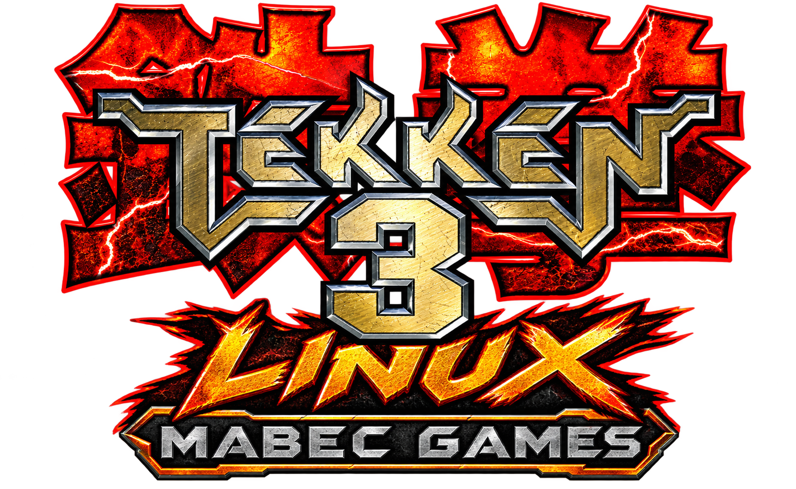
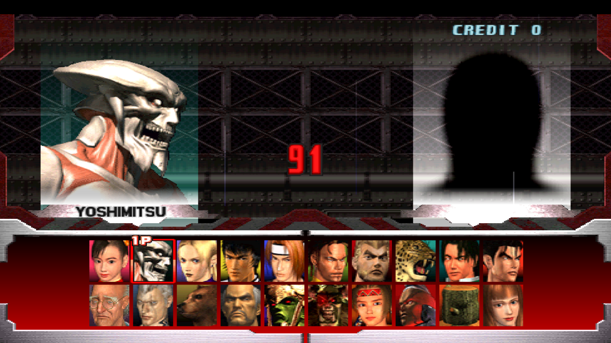
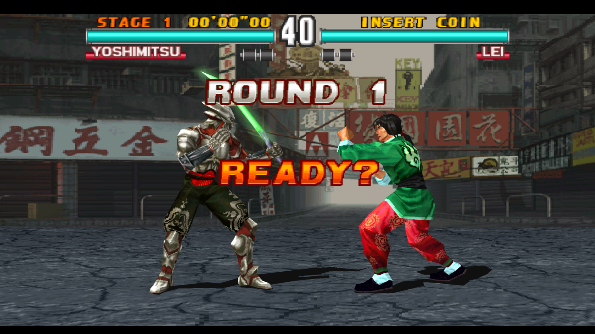

<h3 align="center">Mabec Games presents</h3>

<p align="center">
  
</p>

<h1 align="center">Tekken 3 for Linux</h1>

<p align="center">
  <strong>Native x86_64 Static Recompilation & Enhancement Suite for Tekken 3 (USA, SLUS-00402)</strong><br/>
  True 16:9 Widescreen at Locked 60 FPS &bull; Built-In Mod Manager &bull; Privacy-Preserving P2P Rollback Netplay &bull; Portable Linux AppImage
</p>

---

## Overview

**Tekken 3 for Linux** brings Namco's 1998 PlayStation classic to Linux as a native `x86_64` executable and standalone **AppImage**, built on **PSXRecomp** and **recomp-ui**. Rather than running inside a traditional interpreter emulator, the original `SLUS_004.02` MIPS R3000A binary is statically translated into native C/x86_64 code and paired with a hardware-accelerated OpenGL renderer, an integrated graphical launcher, a declarative Mod Manager, and Peer-to-Peer Rollback Netplay.

| Feature | Details |
|---|---|
| **Required Disc** | *Tekken 3* (USA — `SLUS-00402`, user-supplied `.cue`/`.bin`, `.iso`, or `.chd`) |
| **Platform** | Linux `x86_64` (Standalone Portable AppImage & Source Build) |
| **Frame Rate** | Locked **60.0 FPS** gameplay with HLE deterministic scheduling |
| **View Modes** | **16:9 (True Widescreen)** & **4:3 (Native)** (two-way synced in Settings & Mod Manager) |
| **Rendering** | OpenGL 3.3+ with **1x–4x Supersampling (SSAA)**, **MSAA**, and **Perspective-Correct Texturing** |
| **Netplay** | 2-Player Direct P2P Rollback Netplay via **5-Word Tekken Room Codes** (IP-hidden) |

> **Legal Notice:** You must own an original copy of *Tekken 3 (USA, SLUS-00402)*. No copyrighted PlayStation disc images, audio tracks, or retail Sony BIOS dumps are distributed in this repository or inside the AppImage. An MIT-licensed **OpenBIOS** image is bundled for out-of-the-box booting.

---

## Screenshots

### Native 16:9 True Widescreen — Character Select & Full Roster
<p align="center">
  
</p>

### Native 16:9 True Widescreen — 60 FPS Supersampled Gameplay
<p align="center">
  
</p>

---

## Enhancements & Features

### 1. True 16:9 Widescreen at Locked 60 FPS
Unlike generic aspect-ratio hacks that stretch the 4:3 framebuffer horizontally, **Tekken 3 for Linux** includes a dedicated **True 16:9 Widescreen** static plugin (`tekken3.enhancement.true-widescreen`):
- **Expanded 3D Stage Visibility Cone:** Widens the guest visibility frustum and signed viewport clipping bounds so the original 6×6 stage geometry sections naturally fill the 16:9 frame without stretching fighters or duplicating stage tiles.
- **Native 16:9 Menus & Selectors:** The main menu, Arcade/Versus character select, Team Battle, and Tekken Force loading screens are reconstructed for 16:9 while keeping character portraits, fonts, and HUD elements in their exact original proportions.
- **Wider Fight Framing:** Allows regular 1v1 fights to utilize the wider horizontal arena before the camera pulls back, while preserving original close-range framing, movement speed, hitboxes, and stage boundaries.
- **Instant View Mode Toggle:** Switch between **`16:9 (Widescreen)`** and **`4:3 (Native)`** directly under **Settings → Display → View mode** or inside **MOD MANAGER** — both controls stay automatically synchronized.

### 2. High-Resolution OpenGL Pipeline & Display Presets
- **Internal Supersampling (SSAA):** Render internally at **1x**, **2x**, **3x**, or **4x** native resolution with hardware **MSAA (`Off`, `2x`, `4x`, `8x`)**.
- **Perspective-Correct Texturing:** Eliminates PS1 affine texture warping and polygon swimming across 3D stages and fighter models.
- **Display & Shader Models:** Choose between `Raw`, `CRT`, `Composite`, and `Trinitron` presentation filters, plus `Nearest` or `Bilinear` texture filtering.
- **Desktop & Steam Deck Resolution Presets:**
  - **720p HD:** `960 × 720` (4:3) / `1280 × 720` (16:9)
  - **Steam Deck (800p):** `1066 × 800` (4:3) / `1280 × 720` (16:9)
  - **900p / 960p / 1200p:** `1280 × 960`, `1600 × 900`, `1600 × 1200`
  - **1080p FHD & 1440p QHD:** `1920 × 1080` (16:9), `1920 × 1440` (4:3), `2560 × 1440` (16:9)
  - Full support for **Windowed**, **Borderless Fullscreen**, and **Exclusive Fullscreen**.

### 3. Built-In Mod Manager (13 Pre-Installed Packages)
The launcher's **MOD MANAGER** comes pre-loaded with 13 guarded enhancement and HD texture packages that never modify your original disc files on disk:
- **Gameplay & System Enhancements:**
  - **True 16:9 Widescreen** (`tekken3.enhancement.true-widescreen`)
  - **All Characters Unlocked** (`tekken3.gameplay.all-characters` — unlocks the full roster immediately)
  - **Fast Loading** (`psx.enhancement.fast-loading` — accelerates transitions and stage loads)
  - **CD-ROM Speed** (`psx.enhancement.cd-speed`)
- **HD Stage & UI Packs:**
  - **Forest Stage HD** (`tekken3.visual.forest-hd` — high-resolution background and ground textures)
  - **Anna Portrait Artwork** (`tekken3.art.anna-portrait`)
- **Custom Fighter Skins (with In-Game Outfit Gallery):**
  - **Nina Williams** — *White Satin* (`tekken3.skin.nina-white-satin`)
  - **Ling Xiaoyu** — *Cherry Blossom Ribbon* (`tekken3.skin.xiaoyu-cherry-blossom`)
  - **Anna Williams** — *Jessica Rabbit* (`tekken3.skin.anna-jessica-rabbit`)
  - **Kuma / Panda** — *Polar Bear* (`tekken3.skin.kuma-polar-bear`)
  - **Eddy Gordo** — *Monochrome* (`tekken3.skin.eddy-monochrome`)
  - **Julia Chang** — *Blue Outfit* (`tekken3.skin.julia-blue`)
  - **Heihachi Mishima** — *Tiger Coat* (`tekken3.skin.heihachi-tiger-coat`)

### 4. Independent Music & SFX Volume Controls
Inside the game's **Options → Sounds** menu, adjust **Music Volume** and **SFX Volume** independently (`0–100` in increments of 5) with live preview and persistent save support (`tekken3-sound.ini`).

---

## How Online P2P Netplay Works

**Tekken 3 for Linux** features built-in **2-Player Peer-to-Peer Rollback Netplay** accessible from the **ONLINE** tab in the launcher.

### 1. Privacy-Preserving 5-Word Tekken Room Codes
Instead of exposing raw IP addresses on stream or in chat, endpoints are encoded using an 8-bit session salt into a **5-word Tekken Room Code** drawn from a 256-word Tekken dictionary:
```text
SALT - WORD1 - WORD2 - WORD3 - WORD4
Example: JIN-GODFIST-TEMPLE-IRONFIST-DORYA
```
- **Zero IP Exposure:** Raw IP addresses are never shown on the Host's screen or on the Joining player's verification banner (`✓ Room Code Verified — Ready to connect`).
- **One-Click `[COPY CODE]` & `[NEW CODE]`:** The Host can copy either their **Online / Internet Room Code** (for WAN play) or **Local Network (LAN) Room Code** (for same-Wi-Fi/LAN play), and click **`[NEW CODE]`** at any time to randomize the session salt and generate a brand-new 5-word code.

### 2. Hosting a Match (Player 1)
1. Open the **ONLINE** tab and select **HOST MATCH (PLAYER 1)**.
2. Click **`[COPY CODE]`** on the **Online / Internet Room Code** card (if playing over the Internet with UDP port `7777` forwarded) or the **Local Network (LAN) Room Code** card (if playing on the same LAN/VPN).
3. Send the 5-word Room Code to Player 2 and click **START HOST (WAIT FOR PLAYER 2)**.

### 3. Joining a Match (Player 2)
1. Open the **ONLINE** tab and select **JOIN MATCH (PLAYER 2)**.
2. Paste the Host's 5-word Tekken Room Code into the **Room Code** box (or click **`[PASTE]`**).
3. Once `✓ Room Code Verified — Ready to connect` appears, click **CONNECT TO HOST & LAUNCH**.

### 4. Automatic Player 1 & Player 2 Controller Routing
- **Host (`local_slot = 0`):** Your configured Player 1 device (Gamepad or Keyboard) controls **Player 1** (left side).
- **Joining Player (`local_slot = 1`):** Your configured Player 1 device (Gamepad or Keyboard) is **automatically routed to Player 2** (right side) by the netplay input bridge—no manual P2 controller reassignment is needed.
- **Deterministic Sync:** Netplay sessions automatically run with a clean deterministic state and dual-raster CPU-authoritative VRAM snapshots so rollback/resimulation stays 100% bit-exact between both machines.

---

## Quick Start (Linux AppImage)

1. Download `Tekken_3_for_Linux-x86_64.AppImage`, mark it executable, and run it:
   ```bash
   chmod +x Tekken_3_for_Linux-x86_64.AppImage
   ./Tekken_3_for_Linux-x86_64.AppImage
   ```
2. In the launcher, open **DISC LIBRARY** → **+ Attach image** and select your legal **Tekken 3 (USA, SLUS-00402)** `.cue`, `.bin`, or `.chd` disc image.
3. Configure your gamepad or keyboard under **CONTROLLER** / **KEYBOARD**, customize **MOD MANAGER** and **SETTINGS**, and click **LAUNCH GAME**.

### User Data & Portable Mode
- By default, runtime configuration (`settings.toml`), memory cards (`saves/card1.mcd`, `saves/card2.mcd`), input bindings (`input.ini`, `keybinds.ini`), and mod state (`mods/state.toml`) are stored in:
  ```text
  ~/.local/share/tekken3/run/
  ```
- **Portable Mode:** Create a directory named `portable-data` next to `Tekken_3_for_Linux-x86_64.AppImage` to store all saves, settings, and mods inside that folder instead.

---

## Building from Source on Linux

### Prerequisites
- CMake (`>= 3.20`), Ninja, GCC or Clang (`C11` / `C++17`), Python 3 (`>= 3.10`)
- SDL2 / SDL3, OpenGL, and standard X11/Wayland development headers
- A verified `Tekken 3 (USA, SLUS-00402)` `.cue` / `.bin` disc image in `disc/`

### Build Commands
```bash
# 1. Build the PSXRecomp static emitters
./psxrecomp/tools/ci/build_emitters.sh

# 2. Verify your disc image and generate the C translation units
python3 psxrecomp/psxrecomp_cli.py verify-disc --disc "disc/Tekken 3 (USA).cue"
python3 psxrecomp/psxrecomp_cli.py generate \
  --config game.toml --project-root . --disc "disc/Tekken 3 (USA).cue"

# 3. Configure and compile the native runtime
cmake -S . -B build -G Ninja -DCMAKE_BUILD_TYPE=Release
ninja -C build psx-runtime
```

---

## Modding & Asset Tools

See [`MODDING.md`](MODDING.md) for the verified BNS asset-ID namespace, local extraction workflow, and `.psxmod` packaging format:
- [`tools/bns_tool.py`](tools/bns_tool.py) & [`tools/bns_mod.py`](tools/bns_mod.py) — Inventory, extract, and package guarded BNS records and ARC members ([`tools/BNS_TOOL.md`](tools/BNS_TOOL.md), [`tools/BNS_MOD.md`](tools/BNS_MOD.md)).
- [`tools/tim_tool.py`](tools/tim_tool.py) & [`tools/tim_import.py`](tools/tim_import.py) — Export and re-encode PS1 TIM textures from RGBA PNGs ([`tools/TIM_TOOL.md`](tools/TIM_TOOL.md), [`tools/TIM_IMPORT.md`](tools/TIM_IMPORT.md)).
- [`tools/arc_tool.py`](tools/arc_tool.py) — Extract and deterministically rebuild strict ARC containers ([`tools/ARC_TOOL.md`](tools/ARC_TOOL.md)).
- [`tools/vab_tool.py`](tools/vab_tool.py) — Audit and reconstruct split VH/ARC SPU sound banks ([`tools/VAB_TOOL.md`](tools/VAB_TOOL.md)).
- [`tools/model_map.py`](tools/model_map.py) — Inspect `3DMK` fighter and stage model records ([`tools/MODEL_MAP.md`](tools/MODEL_MAP.md)).
- [`tools/xas_tool.py`](tools/xas_tool.py) & [`tools/xas_mod.py`](tools/xas_mod.py) — Catalog and package strided XA audio and STR video streams ([`tools/XAS_TOOL.md`](tools/XAS_TOOL.md), [`tools/XAS_MOD.md`](tools/XAS_MOD.md)).
